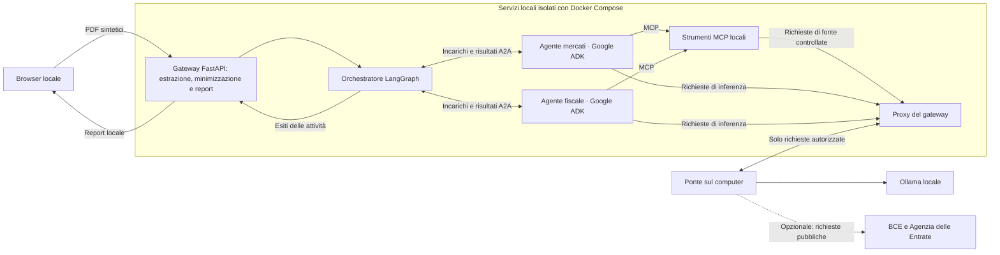

# Analisi locale di documenti finanziari

Prototipo di tesi triennale in Ingegneria Informatica, Università degli Studi di Bergamo. Il progetto studia come più agenti possano collaborare su documenti finanziari usando solo i dati necessari al loro compito. La demo elabora i PDF sintetici inclusi nella repository e produce un report leggibile, con dati documentali, fonti, calcoli e limiti.

Per installare e avviare la demo, segui **[Configurazione per macOS e Windows](docs/CONFIGURAZIONE.md)**.

## Idea del progetto

Un sistema multi-agente suddivide un problema in attività specialistiche. Qui un agente esamina il contesto del mutuo e del mercato, mentre l’altro approfondisce gli interessi del mutuo e il relativo contesto fiscale. Un orchestratore coordina le attività e raccoglie anche esiti parziali.

- **A2A (Agent-to-Agent)** trasporta gli incarichi strutturati e i risultati fra orchestratore e agenti.
- **MCP (Model Context Protocol)** collega gli specialisti agli strumenti che consultano le fonti autorizzate.
- **Minimizzazione dei dati** significa fornire a ciascun agente una vista limitata al compito. Il gateway estrae i dati localmente e controlla destinazioni e richieste. Le viste ridotte non garantiscono l’anonimato.

Il modello sceglie quali enunciati pertinenti evidenziare tra quelli associati alle fonti e ai dati autorizzati. Il gateway ricostruisce testo e riferimenti, verifica la provenienza e svolge i calcoli con regole esplicite. Gli eventuali commenti del modello sono separati dai fatti verificabili e non sono certificati semanticamente.

## Schema dell’architettura

I PDF originali e gli identificativi diretti non vengono inviati agli agenti o alle fonti esterne. Il ponte esegue le inferenze con Ollama sul computer e, se abilitato, interroga gli endpoint pubblici autorizzati. La sessione viene chiusa a fine elaborazione; il server non conserva uno storico dei profili o dei report.

## Cosa si può provare

| Scenario | Dati e risultato |
| --- | --- |
| **S-01 · Mutuo e mercati** | Il prospetto del mutuo alimenta i calcoli teorici locali. Il riferimento di mercato dà contesto; la statistica aggregata BCE non è un’offerta personale né il TAN da usare per una rata alternativa. |
| **S-02 · Interessi e fiscalità** | La certificazione degli interessi alimenta il riepilogo. Se si abilita l’Agenzia delle Entrate, il report cita le condizioni da verificare senza attestare una detrazione o una spettanza. |

Estratto conto e busta paga aggiungono contesto facoltativo: netto, saldi e mesi di riferimento. Le viste ridotte mostrano agli agenti il segno del netto e il segno e l’andamento del saldo, con i mesi; il report locale conserva gli importi e le citazioni. Un singolo mese non dimostra reddito stabile o capacità di rimborso.

Usa i PDF dello stesso fascicolo in `dataset/Documents`. **C001** è un esempio completo; **C006** mostra un esito parziale perché manca il capitale residuo del mutuo. Dalla pagina locale puoi scaricare il report in HTML o JSON oppure stamparlo in PDF. Il parser supporta i modelli del dataset incluso; non è previsto OCR per le scansioni.

## Struttura della repository

| Percorso | Contenuto |
| --- | --- |
| `gateway/` | API, estrazione dai PDF, controlli, orchestrazione LangGraph, interfaccia web e report. |
| `services/` | Agenti Google ADK, interfacce A2A e server MCP. |
| `deployment/` e `compose.*.yaml` | Immagini, isolamento dei servizi e profili di avvio per demo ed esperimenti. |
| `dataset/Documents/` e `dataset/Scripts/` | Fascicoli sintetici e [guida al generatore](docs/GENERAZIONE_DATASET.md). |
| `scripts/` | Configurazione locale, ponte Ollama, verifiche e procedure sperimentali. |
| `tests/` | Test di unità e di integrazione. |
| `evaluation/` | Protocollo strutturato, annotazioni di riferimento e modelli delle schede. |
| `examples/` | Esempi di ingresso strutturato per lo sviluppo locale. |
| `docs/` | Guida di configurazione, protocollo, registro delle prove e risultati. |

Identità dei servizi, ambienti Python ed evidenze prodotte durante le prove restano locali e sono esclusi da Git. Il dataset sintetico necessario alla demo è incluso.

## Valutazione

Il confronto incrocia **agente singolo o specialisti multipli** con **minimizzazione finanziaria attiva o disattivata**. Le quattro configurazioni sperimentali usano lo stesso corpus sintetico, fonti fissate localmente e lo stesso modello. Anche con minimizzazione disattivata si condividono solo campi finanziari strutturati: PDF, testo grezzo e identificativi diretti restano esclusi.

Il confronto finale usa **800 sessioni nominali** su fascicoli estranei al pilota e **60 report** valutati da una sola persona. Sintesi, metodo e dati aggregati sono in [Risultati della rivalutazione](docs/RISULTATI.md).

Per disegno sperimentale, criteri e limiti, consulta il [protocollo di valutazione](docs/PROTOCOLLO_VALUTAZIONE.md) e il [registro delle prove](docs/REGISTRO_PROVE.md).
